<div align="center">



<a href="https://git.io/typing-svg">
  
</a>


</div>

```yaml
╔══════════════════════════════════════════════════════════════════╗
║ [ BANCO_DE_DADOS_NCPD // RESULTADO_DA_VARREDURA ]                ║
╠══════════════════════════════════════════════════════════════════╣
║ ALIAS ......... Lucas Neves                                      ║
║ CLASSE ........ Netrunner Full-Stack // Arquiteto de Automação   ║
║ CORPORAÇÃO .... FATEC // Desenv. de Software Multiplataforma     ║
║ DISTRITO ...... São Paulo, BR [Sub-Rede: 013]                    ║
║ NÍVEL DE CRED . Tier 5 // Arq. Limpa e Sistemas Escaláveis       ║
║ AVISO ......... Risco de ciberpsicose por excesso de café        ║
╚══════════════════════════════════════════════════════════════════╝
```

### `> SHARD_DE_DADOS // BIO.shard`

<a href="https://git.io/typing-svg">
  
</a>

```yaml
╔══════════════════════════════════════════════════════════════════╗
║ [ FICHA DE ATRIBUTOS // V ]                                      ║
╠══════════════════════════════════════════════════════════════════╣
║ INTELIGÊNCIA ......... ████████████████████  20                  ║
║ HABILIDADE TÉCNICA ... ███████████████████░  19                  ║
║ REFLEXOS ............. ████████████████░░░░  16                  ║
║ FRIEZA ............... ███████████████░░░░░  15                  ║
║ CORPO ................ ████████░░░░░░░░░░░░  08                  ║
║                                                                  ║
║ VANTAGEM: Quickhack de Automação // Sinergia Netrunner           ║
╚══════════════════════════════════════════════════════════════════╝
```

---

### `> CYBERWARE // IMPLANTES_INSTALADOS`

<div align="center">
  
</div>

<p align="center">
  
  &nbsp;
  
  &nbsp;
  
  &nbsp;
  
  &nbsp;
  
  &nbsp;
  
  &nbsp;
  
  &nbsp;
  
  &nbsp;
  
  &nbsp;
  
  &nbsp;
  
  &nbsp;
  
  &nbsp;
  
  &nbsp;
  
  &nbsp;
  
  &nbsp;
  
</p>

---

### `> PROTOCOLO_DE_BRECHA // DAEMONS_ATIVOS`

<div align="center">
  
</div>

---

### `> DIAGNÓSTICO_DO_SISTEMA.log`

<div align="center">


</div>

---

### `> LIGAÇÃO_AO_FIXER // CONTATO`

```
   ┌─────────────────────────────────────────┐
   │  > ping lucas.neves                     │
   │  > resposta: 64 bytes // ok             │
   │  > canal: ABERTO                        │
   │  > procure um fixer no Afterlife...     │
   │    ...ou me mande uma mensagem.         │
   └─────────────────────────────────────────┘
```

<div align="center">

<a href="https://www.linkedin.com/in/SEU_USUARIO"></a>
<a href="mailto:SEU_EMAIL"></a>
<a href="https://SEU_PORTFOLIO"></a>

</div>

---

### `> RÁDIO_NIGHT_CITY.mp3`

```
 ▁▂▃▅▆▇█▇▆▅▃▂▁▂▃▅▆▇█▇▆▅▃▂▁  TOCANDO AGORA  ▁▂▃▅▆▇█▇▆▅▃▂▁▂▃▅▆▇█▇▆▅▃▂▁
```

<div align="center">

<a href="https://open.spotify.com/user/SEU_SPOTIFY_ID">
  
</a>

<br/>

`// "Acorde, samurai. Temos uma cidade para queimar." //`


</div>
